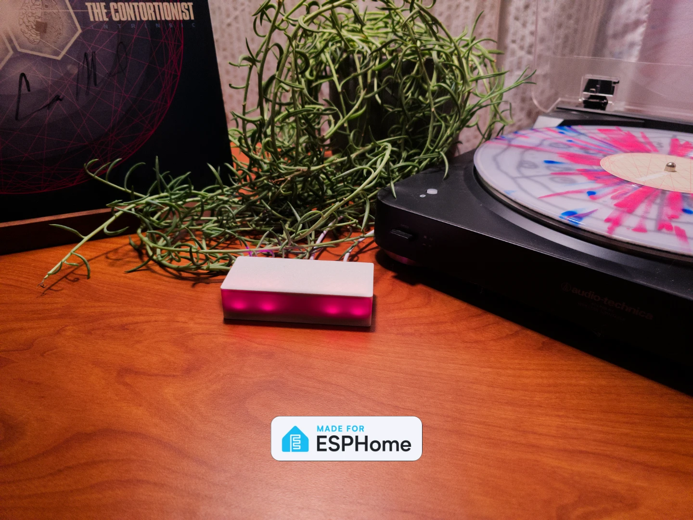

# Apollo CAST PRO-1

  

Make any speakers, receiver or soundbar smart. The CAST PRO-1 shows up in Music Assistant as a player, plays in sync with other rooms over Sendspin, and turns a turntable or TV into a source you can play anywhere in your home. Everything runs locally, with no cloud account or subscription.

**Key features:**

- **Analog or optical output** from one jack: a 3.5mm cable for powered speakers, or a mini-TOSLINK cable for a receiver or soundbar
- **Analog In** for a turntable, TV or other source, streamed to any Music Assistant player
- **Ethernet on board**, with WiFi when no cable is plugged in
- **Multi-room audio** with other CAST PRO-1 and CAST-1 players
- **Onboard RGB LEDs**, plus screw terminals for an addressable LED strip
- **WizMote control**, with each button configurable in Home Assistant
- ESP32-S3 with Bluetooth proxy and Improv WiFi setup over Bluetooth or USB

Power it from a 5V 1A USB-C supply, or 5V 3A if it runs an LED strip. The Ethernet port is data only (no PoE).

To get set up, follow the [Getting Started guide](https://wiki.apolloautomation.com/products/castpro1/setup/getting-started/).

## Audio Output

Set **Audio Output** on the device page to match what's plugged into the **Analog/Optical Out** jack: **Analog** or **Optical**.

## Analog In

Plug a line-level source into the **Analog In** jack, the left of the two 3.5mm jacks. A turntable needs a phono preamp unless it has one built in. The source shows up in Music Assistant as **Sendspin Source (Apollo CAST_PRO-1 xxxxxx)**, and you can play it on the CAST PRO-1 or any other player.

- **Line In Streaming** sets the quality: **Compressed** (the default, best for WiFi) or **Lossless** (for Ethernet or strong WiFi). Changing it restarts the device.
- Analog In and the analog output share a port, so while Analog In streams, the CAST PRO-1 plays through its optical output.

See [Play a source through Analog In](https://wiki.apolloautomation.com/products/castpro1/additional-info/analog-in/) for more.

## Connectivity

One firmware covers both WiFi and Ethernet — there is no need to pick a
variant or reflash to switch:

- **Ethernet plugged in:** traffic moves to Ethernet. If the device is also
  joined to your WiFi, that connection stays up alongside, so Home Assistant
  never loses the device when you plug or unplug the cable. If WiFi has no
  network to join, it turns off entirely — the setup hotspot is never active
  while Ethernet is connected.
- **No Ethernet:** WiFi works as usual. The device rejoins its saved
  network, or opens the "Apollo CAST_PRO-1 Hotspot" for setup if none is
  configured (Improv via Bluetooth or USB works too).

Use the on-device **Network Connection** sensor (Diagnostics) to see which
connection is active at a glance.

## WizMote

The CAST PRO-1 gives you full Home Assistant control over a paired Wiz WizMote. Turn on **WizMote Auto-Discovery** and press a button on the remote to pair it. Each of the nine buttons (On, Off, Night, Brightness Up/Down, and 1–4) can be set to Play, Pause, Play / Pause, Next/Previous Track, Volume Up/Down, Toggle Light, or Send HA Event. The defaults give you media controls out of the box.

Set any button to **Send HA Event** to trigger a custom Home Assistant action — play a Music Assistant playlist, toggle a room's lights, run a scene or script. See [WizMote control](https://wiki.apolloautomation.com/products/castpro1/examples/wizmote-blueprint/) for the blueprint.

## Announcements

While an announcement plays, music ducks and the onboard LEDs light up. Two sliders in Home Assistant set how much:

- **Announcement Ducking** (−80 to 0 dB, default −40) is how far the music drops. 0 turns ducking off.
- **Announcement LED Brightness** (0–100%, default 100%) is how bright the onboard LEDs are. 0 keeps them off.

## External LED Strip

The 5V / GND / IO1 screw terminals drive an addressable LED strip (WS2812, SK6812, WS2811, APA106 or SM16703). Its entities are disabled by default, since most CAST PRO-1s don't have a strip connected. To use one, open the device page in Home Assistant and enable the **LED Strip** entities.

- **Count** is how many LEDs the strip has (up to 300, default 30).
- **Chipset**, **Color Order** and **Max Brightness** describe your strip.
- **Effect A** and **Effect B** are two effect slots, each with its own **Pattern** and **Speed**.

> [!WARNING]
> **Photosensitivity:** Strobe flashes faster than 3 times per second from about Speed 50 up. Flashing in this range can trigger seizures in people with photosensitive epilepsy.

Power long strips from their own 5V supply with a shared ground; the terminals can't supply a full-brightness strip, and **LED Strip Max Brightness** (default 50%) caps the draw. See [Add an LED strip](https://wiki.apolloautomation.com/products/castpro1/examples/led-strip/) for wiring, every effect, and splitting the strip into segments.

## Links

Discord (Support/feedback/discussion/future products): [http://dsc.gg/ApolloAutomation](http://dsc.gg/ApolloAutomation) \
Shop: [https://apolloautomation.com/products/cast-1-pro](https://apolloautomation.com/products/cast-1-pro) \
Wiki: [https://wiki.apolloautomation.com/products/castpro1/introduction/](https://wiki.apolloautomation.com/products/castpro1/introduction/) \
Web installer: [https://install.apolloautomation.com/#/cast-pro-1](https://install.apolloautomation.com/#/cast-pro-1)
