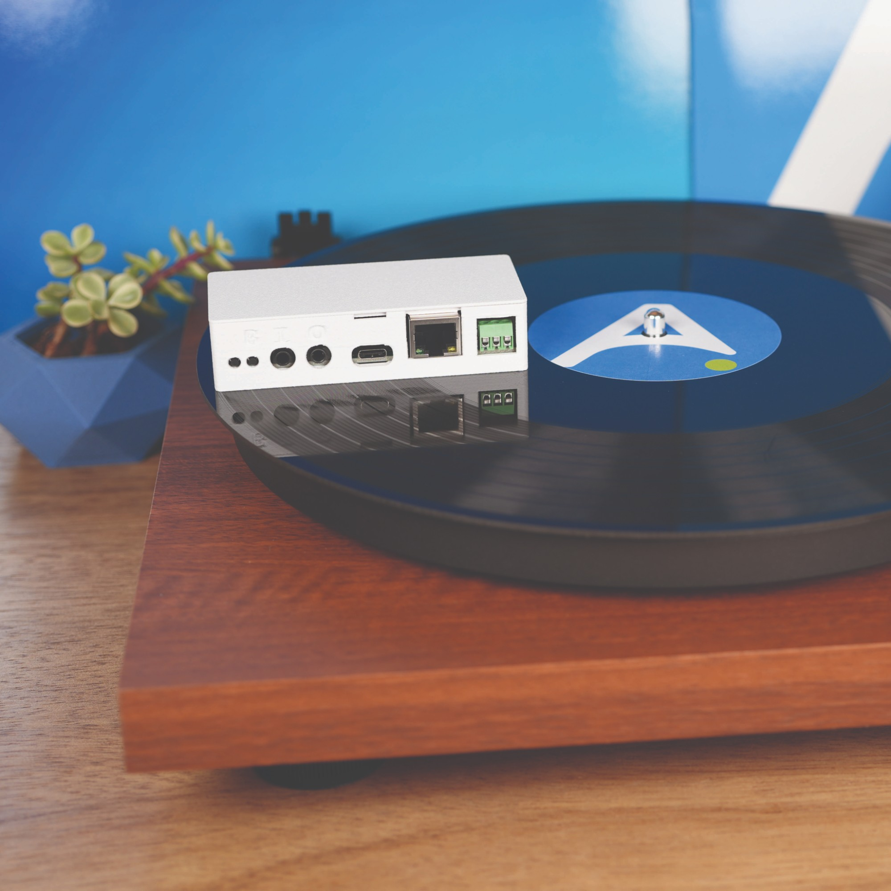

# Apollo CAST PRO-1

  

Make any speakers, receiver or soundbar smart. The CAST PRO-1 shows up in Music Assistant as a player, plays in sync with other rooms over Sendspin, and turns a turntable or TV into a source you can play anywhere in your home through its Analog In (Line In) jack. Everything runs locally, with no cloud account or subscription.

**Key features:**

- **Analog In (Line In)** for a turntable, TV or other source, streamed to any Music Assistant player
- **Analog or optical output** from one jack: a 3.5mm cable for powered speakers, or a 3.5mm-to-TOSLINK cable or adapter for a receiver or soundbar
- **Ethernet on board**, with WiFi when no cable is plugged in
- **Multi-room audio** with other CAST PRO-1 and CAST-1 players, plus a delay setting to line rooms up
- **Onboard RGB LEDs**, plus screw terminals for an addressable LED strip
- **WizMote control**, with each button configurable in Home Assistant
- ESP32-S3 with Bluetooth proxy and Improv WiFi setup over Bluetooth or USB

It works with Home Assistant and Music Assistant 2.10.7 or newer. Power it from a 5V 1A USB-C supply, or 5V 3A if it runs an LED strip. The Ethernet port is data only (no PoE).

To get set up, follow the [Getting Started guide](https://wiki.apolloautomation.com/products/castpro1/setup/getting-started/).

## Audio Output

Set **Audio Output** on the device page to match what's plugged into the **Analog/Optical Out** jack: **Analog** or **Optical**.

## Analog In (Line In)

Plug a line-level source into the **Analog In** jack (also called Line In), the left of the two 3.5mm jacks. A turntable needs a phono preamp unless it has one built in.

1. In Music Assistant, select **Browse**, then **Sendspin Source** followed by your CAST PRO-1's name (Apollo CAST_PRO-1 xxxxxx, unless you renamed it).
2. Pick the player to hear it on. The CAST PRO-1 itself can play it when **Audio Output** is set to **Optical**. With analog speakers, pick another player.

- **Line In Streaming** sets the quality: **Compressed** (the default, best for WiFi) or **Lossless** (for Ethernet or strong WiFi). Changing it restarts the device.
- Analog In and the analog output can't run at the same time. While Analog In streams, this CAST PRO-1 plays only through its optical output.

See [Play a source through Analog In](https://wiki.apolloautomation.com/products/castpro1/additional-info/analog-in/) for more.

## Multi-Room Audio

Group the CAST PRO-1 with other CAST players in Music Assistant to play the same music in sync across every room. If a soundbar or receiver makes one room play a little late, go to **Settings → Players** in Music Assistant, open that CAST PRO-1, and raise **Static playback delay (ms)** until the rooms line up. It starts at 0.

## Connectivity

One firmware covers both WiFi and Ethernet, so there is no need to pick a variant or reflash to switch:

- **Ethernet plugged in:** traffic moves to Ethernet. If the device is also joined to your WiFi, that connection stays up alongside, so Home Assistant never loses the device when you plug or unplug the cable. If WiFi has no network to join, it turns off entirely, and the setup hotspot is never active while Ethernet is connected.
- **No Ethernet:** WiFi works as usual. The device rejoins its saved network, or opens the "Apollo CAST_PRO-1 Hotspot" for setup if none is configured (Improv via Bluetooth or USB works too).

When you join the hotspot, your phone should open the WiFi setup page on its own. If it doesn't, go to [http://192.168.4.1/setup](http://192.168.4.1/setup). The bare http://192.168.4.1 address opens the device's web page instead.

Use the **Network Connection** sensor (under Diagnostic on the device page) to see which connection is active at a glance. The **Bluetooth Proxy** switch is off by default. Turn it on to use the CAST PRO-1 as a Bluetooth proxy for Home Assistant.

## Status Check and Factory Reset

The boot button is the second recessed button from the left, next to reset. Press it with a pin:

- **Hold about 3 seconds** for a status check. The onboard LEDs show **blue** when connected to Home Assistant, **green** when on your network without Home Assistant, or **yellow** with no network. They then flash green once more to show the component check passed.
- **Hold 10 seconds** to factory reset. Unplug the Ethernet cable first, since the setup hotspot only appears without it.

See [Status check and factory reset](https://wiki.apolloautomation.com/products/castpro1/troubleshooting/castpro1-boot-button/) for more.

## Firmware Updates

Install updates from the **Firmware Update** entity on the device page. **Firmware Channel** picks **Stable** or **Beta**. See [Switch to beta firmware](https://wiki.apolloautomation.com/products/general/setup/switch-to-beta-branch/).

## WizMote

The CAST PRO-1 gives you full Home Assistant control over a paired Wiz WizMote. Turn on **WizMote Auto-Discovery** and press a button on the remote to pair it. Each of the nine buttons (On, Off, Night, Brightness Up/Down, and 1–4) can be set to Nothing, Play, Pause, Play / Pause, Next/Previous Track, Volume Up/Down, Toggle Light (the onboard LEDs), or Send HA Event. The defaults give you media controls out of the box.

Set any button to **Send HA Event** to trigger a custom Home Assistant action, like playing a Music Assistant playlist, toggling a room's lights, or running a scene or script. See [WizMote control](https://wiki.apolloautomation.com/products/castpro1/examples/wizmote-blueprint/) for the blueprint.

## Announcements

While an announcement plays, music ducks and the onboard LEDs light up. Two sliders in Home Assistant set how much:

- **Announcement Ducking** (−80 to 0 dB, default −40) is how far the music drops. 0 turns ducking off.
- **Announcement LED Brightness** (0–100%, default 100%) is how bright the onboard LEDs are. 0 keeps them off.

See [TTS and announcements](https://wiki.apolloautomation.com/products/castpro1/examples/tts-announcements/) for examples.

## External LED Strip

The 5V / GND / IO1 screw terminals drive an addressable LED strip (WS2812, SK6812, WS2811, APA106 or SM16703). Its entities are disabled by default, since most CAST PRO-1s don't have a strip connected. To use one, open the device page in Home Assistant and enable the **LED Strip** entities.

- **Count** is how many LEDs the strip has (up to 300, default 30).
- **Chipset**, **Color Order** and **Max Brightness** describe your strip.
- **Effect A** and **Effect B** are two effect slots, each with its own **Pattern** and **Speed**.
- **Music Mode** turns the strip on with the **Music Effect** while music plays.

> [!WARNING]
> **Photosensitivity:** Strobe flashes faster than 3 times per second from about Speed 50 up, and Pulse from about Speed 75. Flashing in this range can trigger seizures in people with photosensitive epilepsy.

Power long strips from their own 5V supply with a shared ground. The terminals can't supply a full-brightness strip, and **LED Strip Max Brightness** (default 50%) caps the draw. See [Add an LED strip](https://wiki.apolloautomation.com/products/castpro1/examples/led-strip/) for wiring, every effect, and splitting the strip into segments.

## Links

Discord (Support/feedback/discussion/future products): [http://dsc.gg/ApolloAutomation](http://dsc.gg/ApolloAutomation) \
Shop: [https://apolloautomation.com/products/cast-1-pro](https://apolloautomation.com/products/cast-1-pro) \
Wiki: [https://wiki.apolloautomation.com/products/castpro1/introduction/](https://wiki.apolloautomation.com/products/castpro1/introduction/) \
Web installer: [https://apolloautomation.github.io/CAST_PRO-1/](https://apolloautomation.github.io/CAST_PRO-1/)
